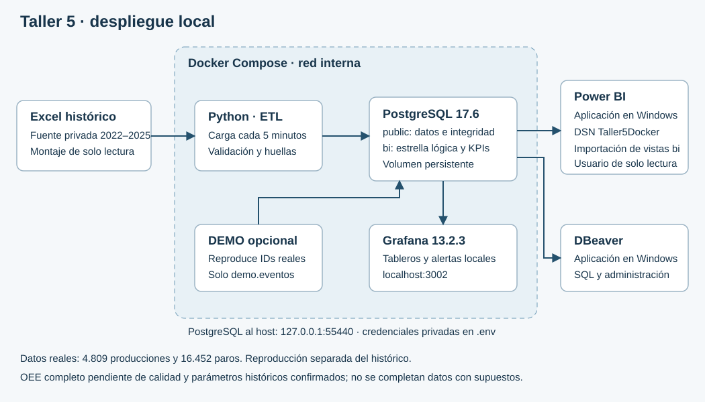

# Taller 5 · Producción y paros

Repositorio privado de entrega: [savelasquezs/Taller5-BI](https://github.com/savelasquezs/Taller5-BI). Acceso sujeto a la invitación del propietario.

PostgreSQL 17.6, Python 3.14, Grafana 13.2.3 y Power BI. La fuente es el Excel histórico de Vinilos_1 a Vinilos_4. Disponibilidad y productividad se reconstruyen con reglas documentadas; no se inventan cantidades buenas ni vigencias de parámetros para completar OEE.



## Arranque desde cero

1. Instalar e iniciar Docker Desktop con contenedores Linux y Docker Compose.
2. Copiar `.env.example` como `.env` y cambiar sus cuatro contraseñas. No dejar `CAMBIAR`. Esas claves se usan al crear los volúmenes por primera vez.
3. Obtener del taller el Excel original y colocarlo en la raíz con su nombre original, o ajustar `EXCEL_PATH` en `.env`. El archivo y los datos personales no se publican en Git.
4. Ejecutar desde esta carpeta:

```bash
docker compose up -d --build
```

El primer arranque crea tablas, restricciones, catálogos, vistas y roles. El ETL carga los operadores desde la lista de la fuente y después producción/paros; repite la carga cada cinco minutos. Durante esa primera carga puede haber indicadores vacíos. Grafana incorpora automáticamente fuente, tres tableros y tres alertas.

| Herramienta | Conexión |
| --- | --- |
| Grafana | http://localhost:3002 · usuario `admin` · clave `GRAFANA_PASSWORD` |
| DBeaver, administración | PostgreSQL · `localhost:55440` · base `taller5` · usuario `taller5` · clave `POSTGRES_PASSWORD` |
| Power BI y consultas de lectura | Igual host/base · usuario `taller5_bi` · clave `BI_PASSWORD` |

Las contraseñas están solo en `.env`, excluido de Git y del contexto de construcción. La base y Grafana se publican exclusivamente en la interfaz local. Las instalaciones anteriores en 55439/3001 no se modifican.

## Power BI y DBeaver

Instalar DBeaver Community en Windows; puede incluir Java. Conectar con la fila de administración anterior para revisar DDL y ejecutar `08_consultas_analiticas.sql`.

Power BI también se ejecuta en Windows. Instalar PostgreSQL ODBC Unicode x64, crear el DSN de usuario **Taller5Docker** con el usuario de lectura y abrir `powerbi/Taller5.pbip`; pulsar **Actualizar**. En este equipo `python configurar_cliente.py` utiliza el controlador ya extraído en `%USERPROFILE%/Taller5Datos/ODBC`. En otro equipo crear el mismo DSN con el administrador ODBC de 64 bits.

Ante el diálogo de credenciales ODBC, elegir **Default or Custom** y dejar vacía la cadena opcional. No es necesario publicar en Power BI Service. El proyecto PBIP/BIM/PBIR se versiona porque sus archivos de texto permiten revisar cambios; La entrega privada vigente es **`powerbi/Taller5_Docker.pbix`**, guardada y verificada con datos de Docker. `powerbi/Taller5.pbix` conserva la versión anterior y no es el archivo final. Ambos contienen datos y quedan fuera de Git.

## Demostración en vivo

```bash
docker compose --profile demo up -d --build
```

Abrir el tablero **Reproducción histórica en vivo**. Cada 60 segundos se emite un registro real completo, avanzando una hora virtual: registro normal, registro con más de 60 minutos de paro y registro normal. Se conserva el ID y la fecha original. Sus pacas/paros pertenecen al registro original, no a una hora real de producción. La nueva hora de emisión es metadato de reproducción.

La alerta DEMO se evalúa cada diez segundos, con diez segundos de espera, y se activa con el segundo paso; se recupera en el tercero. El umbral ilustra una hora de pérdida en el registro original; no es un objetivo aprobado por planta. El perfil escribe únicamente en `demo.eventos`; los tableros históricos y Power BI siguen leyendo `bi`. Al reiniciar la reproducción comienza otra secuencia identificada por UUID. No se sintetizan cantidades ni calidad.

## Comprobaciones y operación

```bash
docker compose ps
docker compose logs --tail 30 etl
docker compose exec -T etl python ejecutar_carga.py
docker compose stop demo
docker compose down
docker compose up -d
```

`down` conserva los volúmenes. **No usar `down -v` con datos que se quieran conservar.** Cambiar claves en `.env` no cambia automáticamente las de una base o Grafana ya inicializados. Para probar desde cero sin borrar la instalación, usar otro nombre de proyecto, otros puertos y otra carpeta de logs.

En Windows, con dependencias instaladas: `python verificar_docker.py` comprueba totales, jerarquía, permisos y consultas de los tableros; no imprime contraseñas. El perfil demo debe estar levantado para demostrar la alerta. Los resultados quedan en `logs/docker/`, fuera de Git. Las pruebas del ETL usan esquemas aislados mediante `ETL_TEST_DATABASE_URL`; los scripts 03 y 06 revierten sus datos de prueba.

Resultado histórico esperado: 4.809 producciones, 16.452 paros, 378.727 pacas, 38.047,35 horas y 502.924,10 minutos de paro. La repetición reconoce las 4.809 producciones sin cambios. Se conservan 70 errores y 3.392 advertencias de origen.

## Respaldo y restauración

Guardar el respaldo fuera de Git. `docker compose cp` evita redirecciones binarias de PowerShell:

```bash
docker compose exec -T db pg_dump -U taller5 -d taller5 -Fc -f /tmp/taller5.dump
docker compose cp db:/tmp/taller5.dump ./respaldo.dump
```

Para restaurar, crear otro proyecto/volumen con una base vacía, copiar allí el archivo y ejecutar `pg_restore -U taller5 -d <base_vacia> --exit-on-error /tmp/taller5.dump`. No restaurar encima de las tablas ya inicializadas. El respaldo contiene datos personales: acceso privado y almacenamiento protegido.

## Documentación y entrega

- `DOCUMENTACION.md`: usuarios, modelo, matriz de bus, indicadores, seguridad y evolución a PLC/SCADA.
- `docs/diccionario_datos.csv`: tipos, llaves, origen y transformación de cada campo analítico.
- `DECISIONES_ETL.md`: reglas y sus efectos; `INVESTIGACION_OEE.md`: evidencia de los parámetros históricos contradictorios.
- `EVIDENCIAS.md`: capturas y descripciones breves para el informe del estudiante.
- `08_consultas_analiticas.sql`: producción, Pareto, comparativos, disponibilidad, jerarquía y anomalías.

Las cantidades mínimas ausentes del texto pegado del enunciado requieren contrastar el original íntegro antes de afirmar cumplimiento completo. OEE real continúa pendiente de unidades buenas/rechazadas y parámetros con vigencia respaldada. Ambos integrantes deben aportar y dominar su trabajo; no se simula participación en Git.
